# City Simulation gallery

Explore the city by day and night, watch a flight come and go, and look closer at the buildings, parks and streets that make up its neighbourhoods. Buildings, trees and vehicle colours vary, so these images show a selection of what you might see.

[Back to City Simulation](README.md)

## Day and night

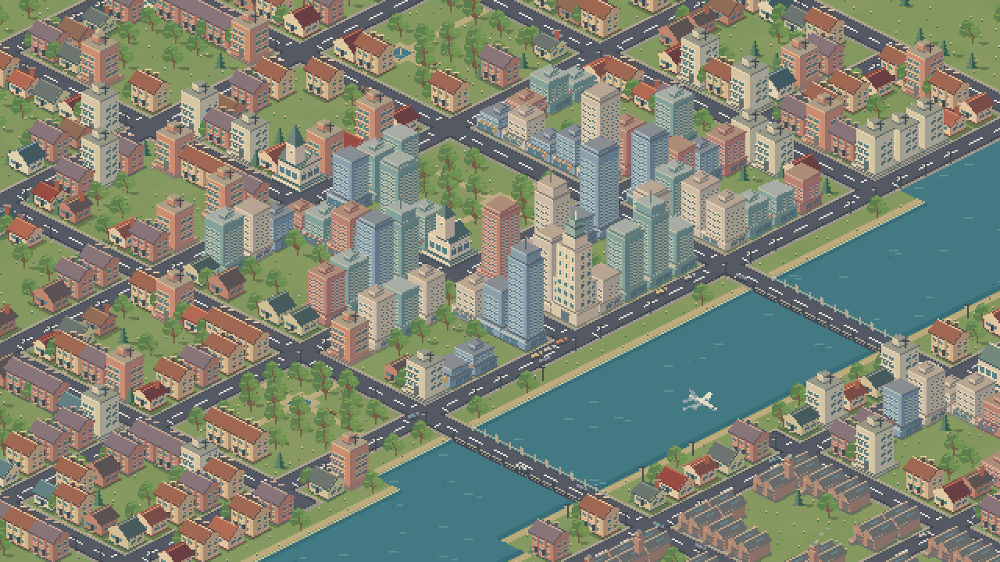

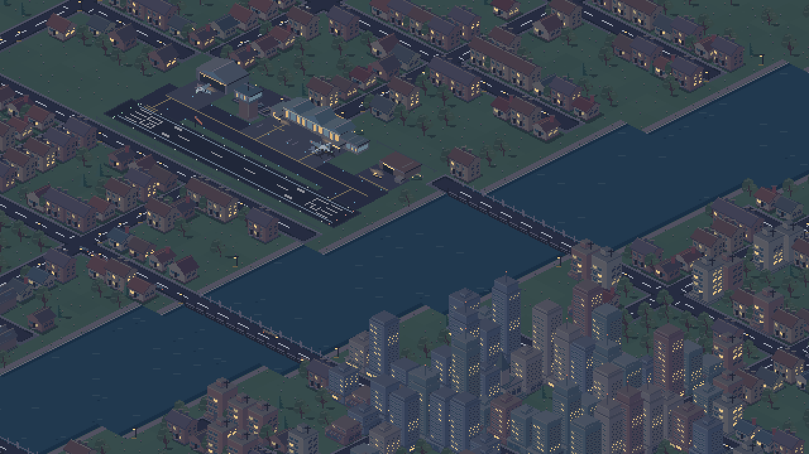

## Seasons and weather

Blossom, summer greenery, autumn colours and bare winter branches give the city a different character throughout the year. Simulation World adds passing clouds, rain, snow and wind.

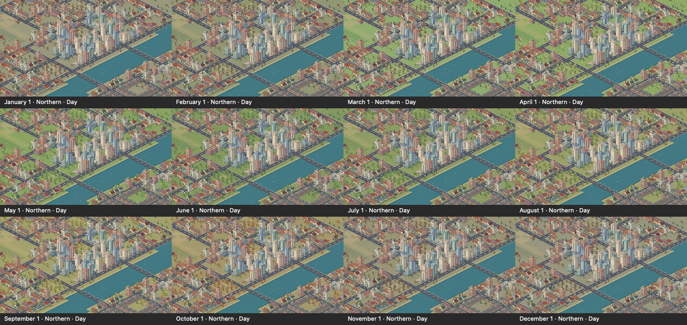

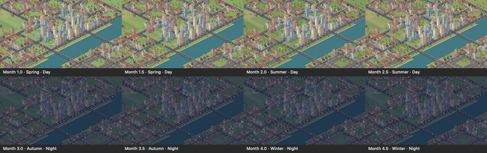

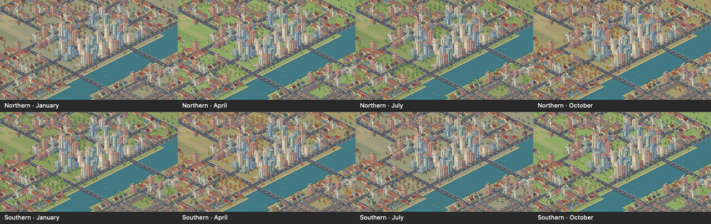

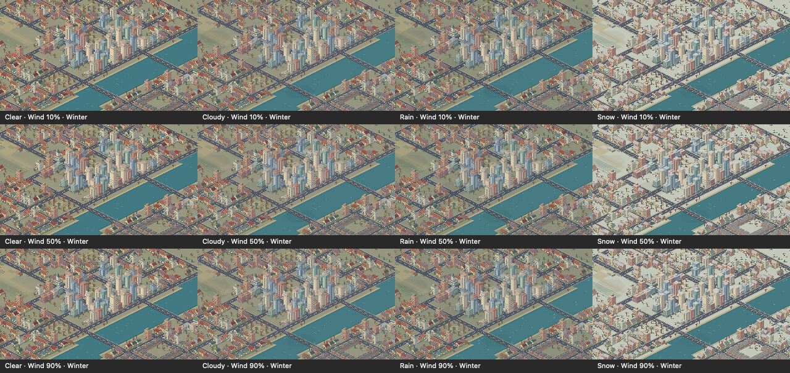

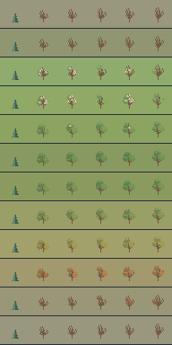

## Airports and aircraft

A grass airfield grows into a paved local airport, then adds a second boarding stand and a maintenance yard. The flight cycle plays at 6× speed with a shortened stop at the gate.

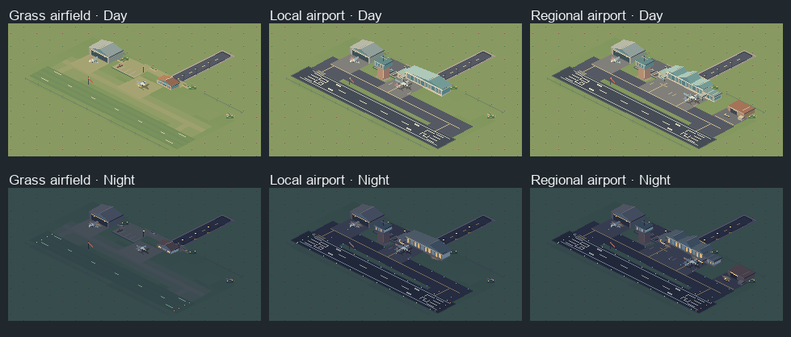

| Airport in daylight | Airport at night |
| --- | --- |
| 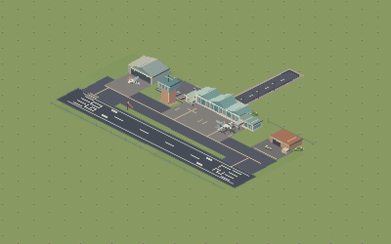 | 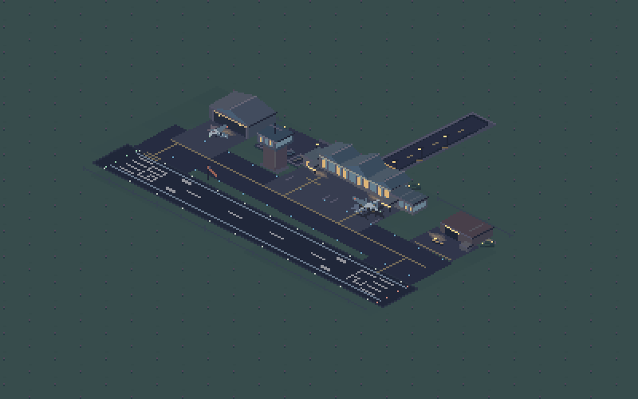 |

| Passenger terminal | Air traffic control tower | Hangar |
| --- | --- | --- |
| 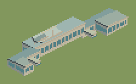 | 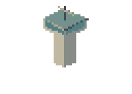 | 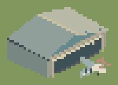 |
| **Passenger aircraft** | **Aircraft in flight** | **Aircraft at night** |
| 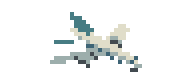 | 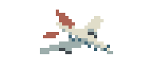 | 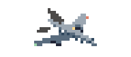 |

## Buildings

| House · level 1 | Terraced homes · level 2 | Apartments · level 3 |
| --- | --- | --- |
| 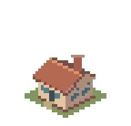 | 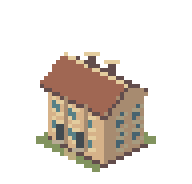 | 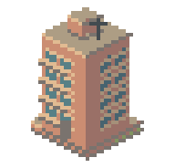 |
| **Shop · level 1** | **Commercial block · level 2** | **Office building · level 3** |
| 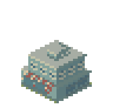 | 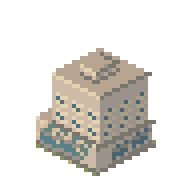 | 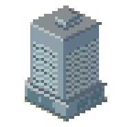 |
| **Office tower · level 4** | **Commercial high-rise · level 5** | **Riverside tower · level 5** |
| 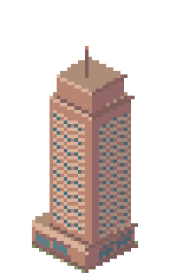 | 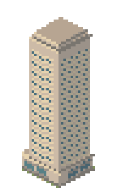 | 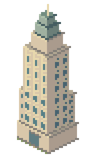 |
| **Factory** | **Factory with chimney** | |
| 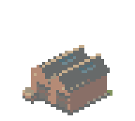 | 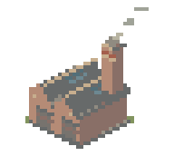 | |
| **Civic clock tower** | **Civic hall** | **Civic pavilion** |
| 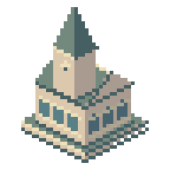 | 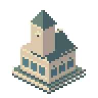 | 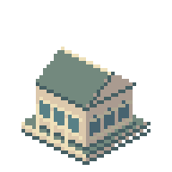 |

## Terrain and parks

| Grass | River with water glints | River edge |
| --- | --- | --- |
| 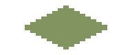 |  |  |
| **West-bank promenade** | **East-bank promenade** | **Park lawn** |
| 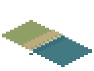 | 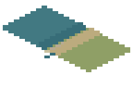 | 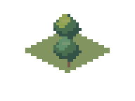 |
| **Park path** | **Park bench** | **Park fountain** |
| 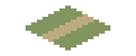 | 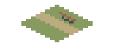 | 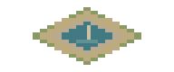 |

## Streets

These streets use the UK convention, with broken white centre lines and white stop lines across the lanes approaching controlled junctions.

| Straight street | Street corner | Dead end |
| --- | --- | --- |
| 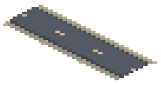 | 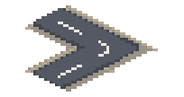 | 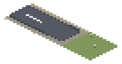 |
| **T-junction** | **Crossroads** | **Bridge** |
| 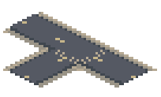 | 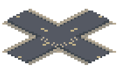 | 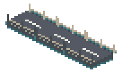 |

## Street furniture, trees and traffic

| Tree | Streetlamp | Lit streetlamp |
| --- | --- | --- |
| 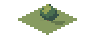 | 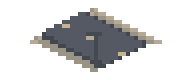 | 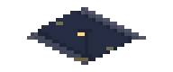 |
| **Car** | **Truck** | **Car at night** |
| 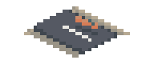 | 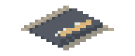 | 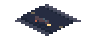 |

## Construction

| Building foundation | Building frame | Building shell |
| --- | --- | --- |
| 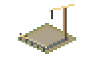 |  |  |
| **Marked road site** | **Road paving** | |
|  |  | |
