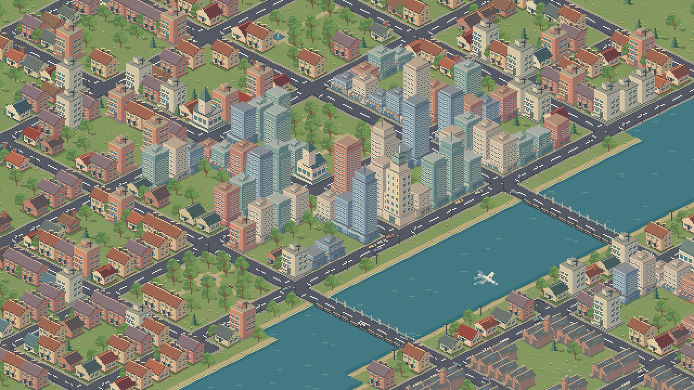
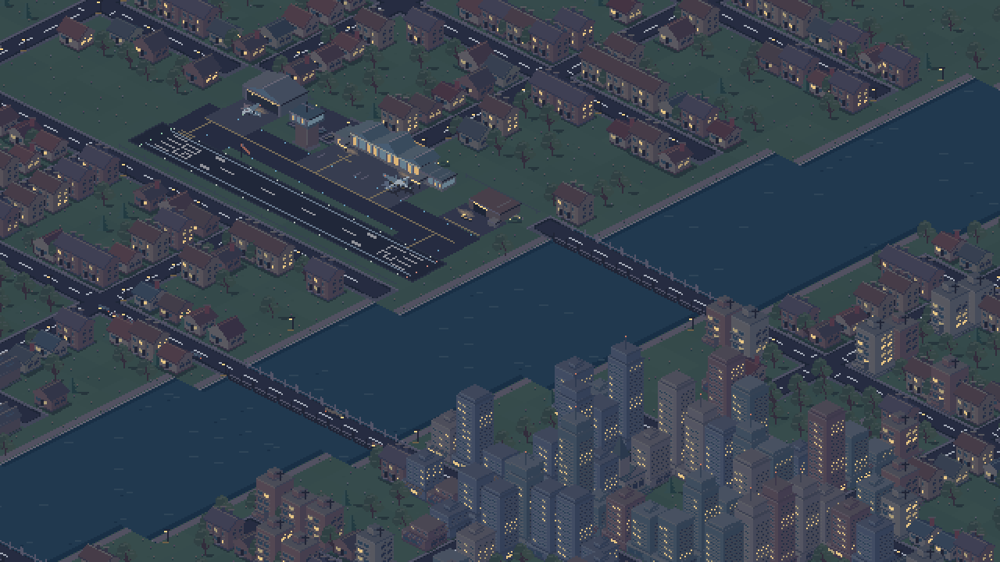

# City Simulation

A little city with a life of its own. Neighbourhoods grow, cars cross the river and aircraft pass over the skyline. City Simulation brings an evolving miniature world to your Mac, with something new to spot each time you visit.

**[Download for macOS](https://github.com/thomasturrell/live-simulation-wallpapers/releases)** · Requires macOS 26 or later.

The city comes to life while your screen saver runs, then becomes a still cityscape on your desktop, ready to carry on next time.

## A living city

Start with a bustling city and watch its neighbourhoods develop. Cranes overlook construction sites as buildings rise from foundations to finished homes and offices. New streets make room for growth, while parks and riverside paths keep their place beside the changing skyline.

Cars travel between homes, shops, offices and factories, crossing bridges and queuing at busy junctions. Look closer for fountains, glinting water and chimney smoke.

Some cities have a small regional airport on the outskirts. Watch passenger aircraft descend, land and taxi to the terminal before heading out for take-off. Even without an airport, you may spot a plane passing overhead.

## Day, night, seasons and weather

Spring blossom gives way to green summer parks, autumn colours and bare winter branches. After dark, windows glow, streetlights shine and headlights trace the roads.

Choose an **Environment** in System Settings → Wallpaper or Screen Saver:

| Environment | What you’ll see |
| --- | --- |
| **Simulation World** (default) | The city follows its own day and night, with changing seasons, clear skies, clouds, rain and occasional snow. |
| **Real World · Northern Hemisphere** | Seasonal colours follow the real calendar for the Northern Hemisphere. |
| **Real World · Southern Hemisphere** | Seasonal colours follow the real calendar for the Southern Hemisphere, with summer and winter reversed. |

Both Real World modes stay dry, with daytime or night-time lighting that follows your Mac’s Light/Dark appearance.

In Simulation World, showers darken the roads and leave puddles. Snow settles on trees and rooftops before gradually thawing, and breezes carry little leaves and seeds across the scene.

## Gallery

*The same miniature world takes on a quieter glow after dark.*

## Install on macOS

1. Download **City-Simulation-Native-Wallpaper.zip** from [GitHub Releases](https://github.com/thomasturrell/live-simulation-wallpapers/releases) and unzip it.
2. Move **City Simulation Wallpaper.app** into **Applications**, open it once and click **Done**. Keep the app in Applications.
3. Reopen **System Settings → Wallpaper** and choose **City Simulation**. Then select it under **Wallpaper → Screen Saver → Custom** too.

Repeat for any other displays or Spaces where you want the city. Start your screen saver or lock your Mac to watch it come to life. If it does not appear in Settings straight away, quit and reopen System Settings.

## Compatibility

Requires **macOS 26 or later**. The download supports both Apple silicon and Intel Macs.

[Developer documentation](DEVELOPMENT.md) — building, testing, configuration and implementation notes.
