# City Simulation

Watch an established isometric city grow. Each display starts with its own river, bridges and street grids, generated from its display UUID. Cars commute between homes, shops, offices and factories, and queue at larger junctions. Buildings go up in stages and lights come on across the city at dusk. All of the pixel art is drawn by the renderer and covered by the repository’s MIT licence.

Generated cities have a 25% chance of a small regional airport on the outskirts when suitable land is available. Its compact 12 × 6 lot site includes a marked runway, taxiways, apron, passenger terminal, control tower, hangars and connected access roads. The site and low approach corridors stay clear of new development; rivers, parks and promenades are preserved. The fixed default preview city includes an airport.

Occasional passenger aircraft approach, descend, land, slow down and taxi to the terminal. After a 45–95 second stop they push back, taxi out, hold short, line up and accelerate into a climbing departure. The single stand and runway serve one flight at a time, with quiet intervals of 45–109 seconds between visits and longer intervals at night. Passenger trips add a few cars to the terminal roads. Independent overflights occasionally cross cities with or without an airport. Aircraft share the city's simulation clock, lighting and depth rendering, including small shadows, cabin windows, engines, landing gear and navigation lights.

## Install on macOS

1. Download and unzip `City-Simulation-Native-Wallpaper.zip` from [GitHub Releases](https://github.com/thomasturrell/live-simulation-wallpapers/releases), or build the wallpaper with the command below.
2. Move **City Simulation Wallpaper.app** into Applications and open it once. The app registers its wallpaper extension with PlugInKit. Click **Done** to quit the installer and leave the bundle in Applications.
3. Reopen System Settings. In **Wallpaper**, select **City Simulation** as the wallpaper. In **Wallpaper → Screen Saver → Custom**, select **City Simulation** as the screen saver. Repeat for each display or Space where you want it.
4. Start the screen saver or lock the Mac. The city animates on active saver surfaces. On return to the desktop, the extension brings the same scene to a stop over four seconds when WallpaperAgent keeps the live surface visible.

The ZIP contains `City Simulation Wallpaper.app` with the embedded `CityWallpaper.appex`, this `README.md`, `LICENSE` and the `assets/` images used in the gallery below.

The extension targets macOS 26 or later. The build script produces an ad-hoc signed universal app and ZIP by default. Set `CITY_SIGN_IDENTITY` to a Developer ID Application identity when building for distribution, then notarise the signed app. The carrier exits after registration. macOS hosts the animation and supplies the desktop image.

WallpaperAgent’s wallpaper extension interface is undocumented and may change with OS updates. Registration alone does not prove the extension will appear in both pickers. WallpaperAgent controls when it switches from a live layer to a cached image, so part or all of the slowdown may be hidden. If macOS withdraws the surface, City Simulation saves its current state and stops playback immediately. Per-display generation and restore require macOS to supply a display ID that maps to a Core Graphics display UUID. Previews and requests without that identifier use the default city and session-only state.

## Build and preview

Use a Swift 6 toolchain with the macOS 26 SDK or newer. From this directory:

```sh
./NativeWallpaper/build.sh
./Packaging/test.sh
swift run -c release CityPreview
swift run -c release CityPreview --png /tmp/city-5k.png 5120 2880
swift run -c release CityPreview --png /tmp/city-at-night.png 1280 720 270
swift run -c release CityPreview --png /tmp/city-airport.png 1280 720 100
```

The first command produces the app and ZIP in `dist/`. Pass an output directory as the first argument to write them elsewhere, or set `CITY_NATIVE_ARCHS` to limit the architecture slices. The resizable preview window animates immediately without installing the extension. PNG export takes an optional width, height and time in simulated seconds. At the default seed, the first construction site opens after nine seconds and completes after fifteen.

For a probe of the native interfaces, build and run the probe from a graphical macOS login session:

```sh
CITY_BUILD_ABI_PROBE=1 ./NativeWallpaper/build.sh
state_dir="$(mktemp -d)"
.build/native-wallpaper/verify-wallpaper \
  "dist/City Simulation Wallpaper.app/Contents/Extensions/CityWallpaper.appex/Contents/Resources/city-thumbnail.png" \
  "$state_dir"
```

The probe exercises the real wallpaper settings and request types, remote Core Animation contexts, IOSurface snapshots, and the adapter’s playback, suspension, settling and persistence. Use `verify-wallpaper --local` with the same paths to exercise the settings, snapshots and lifecycle without allocating remote contexts. The probe runs outside WallpaperAgent. Before distributing, verify installed picker discovery, saver playback and lock/unlock from System Settings, display hot-plug and mirroring, Spaces, sleep and wake, and the idle energy profile on your target macOS versions.

## Generated assets

These WebP previews use the simulation’s pixel art. The renderer varies building details, tree shapes and vehicle colors, so the gallery shows representative styles.

### Airports and aircraft

These previews show the compact airport and its aircraft using the same renderer as the wallpaper. The flight cycle plays at 6× speed with a shortened stop at the terminal.


| Airport in daylight | Airport at night |
| --- | --- |
| 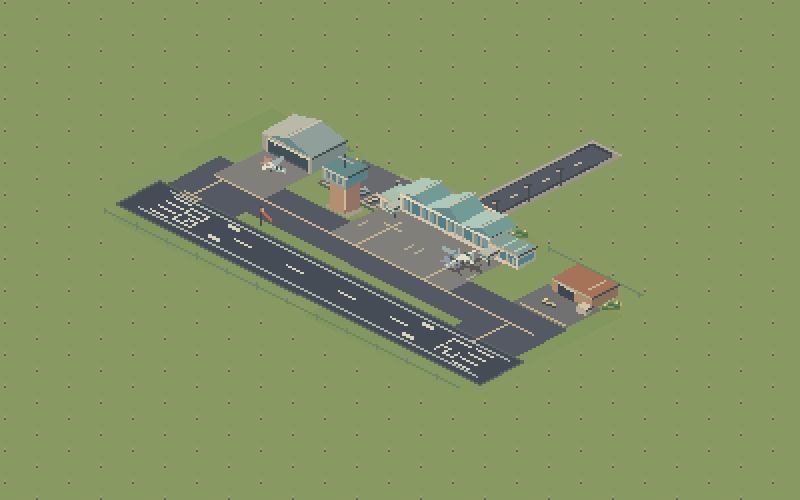 |  |

| Passenger terminal | Air traffic control tower | Hangar |
| --- | --- | --- |
|  | 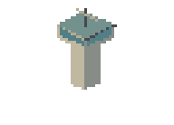 |  |
| **Passenger aircraft** | **Aircraft in flight** | **Aircraft at night** |
| 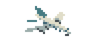 |  |  |

### Buildings

| House · level 1 | Terraced homes · level 2 | Apartments · level 3 |
| --- | --- | --- |
|  |  |  |
| **Shop · level 1** | **Commercial block · level 2** | **Office building · level 3** |
| 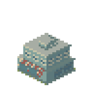 | 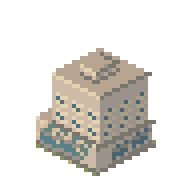 |  |
| **Office tower · level 4** | **Commercial high-rise · level 5** | **Riverside tower · level 5** |
|  |  |  |
| **Factory** | **Factory with chimney** | |
|  |  | |
| **Civic clock tower** | **Civic hall** | **Civic pavilion** |
| 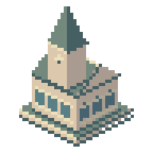 | 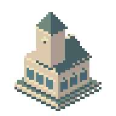 |  |

### Terrain and parks

| Grass | River with water glints | River edge |
| --- | --- | --- |
|  |  |  |
| **West-bank promenade** | **East-bank promenade** | **Park lawn** |
|  |  |  |
| **Park path** | **Park bench** | **Park fountain** |
|  | 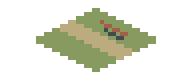 |  |

### Streets

| Straight street | Street corner | Dead end |
| --- | --- | --- |
| 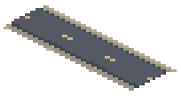 |  | 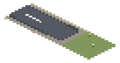 |
| **T-junction** | **Crossroads** | **Bridge** |
| 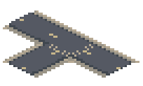 | 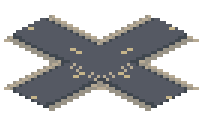 |  |

### Street furniture, trees and traffic

| Tree | Streetlamp | Lit streetlamp |
| --- | --- | --- |
|  |  | 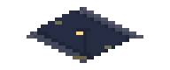 |
| **Car** | **Truck** | **Car at night** |
|  |  | 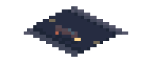 |

### Construction

| Building foundation | Building frame | Building shell |
| --- | --- | --- |
| 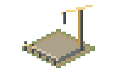 |  |  |
| **Marked road site** | **Road paving** | |
|  |  | |

### Preview and app images


| Wallpaper picker thumbnail | Installer app icon | Night scene export |
| --- | --- | --- |
| 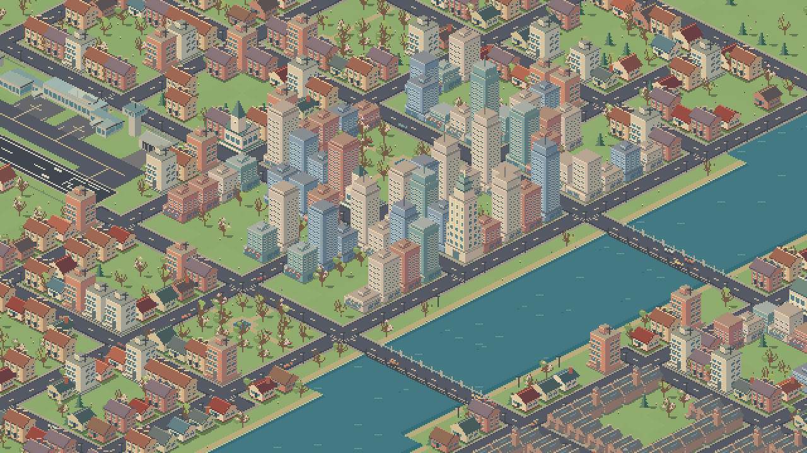 | 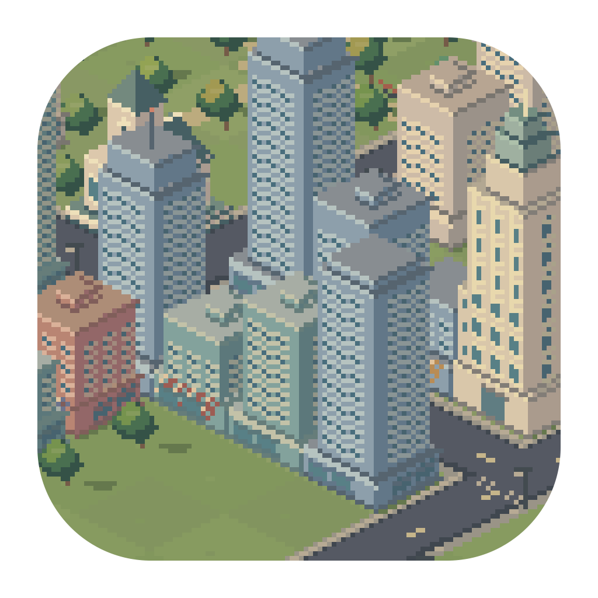 |  |

## Implementation

- **CityEngine** owns a seedable 56 × 56 city and advances it at 30 fixed ticks per second. It routes trips on a connected road graph, balances development between housing and jobs, and enforces frontage and density limits. New road segments open frontage for future projects. Parks and riverbanks stay protected.
- **CityArt** draws original pixel art onto a virtual canvas. It caches terrain, airport facilities, buildings and their occlusion data, then adds road traffic, aircraft, water glints and chimney smoke. Playback samples the simulation up to 20 times per second. The desktop, snapshots and development preview use the same renderer and integer scaling.
- **NativeWallpaper** uses the same WallpaperAgent bridge as Game of Life. It atomically checkpoints each identified display to the extension’s Application Support directory about every 15 seconds of active simulation and at lifecycle transitions. A checkpoint includes the city clock, lots, current construction, vehicle trips, flight phases and schedules, and random state. Existing version 2 checkpoints retain their original map and gain overflights; airports are placed when a new city is generated. Version 3 airports shrink to the compact footprint, releasing the spare land for development while preserving city progress, access streets and passenger trips. The 25% chance applies to newly generated cities. Settings previews use disposable state. When the desktop settles, the timer stops and the final frame stays in place until the next session.

The private integration follows the [Game of Life native extension](../Game%20of%20Life/NativeWallpaper/INSTALL.md) and [Aerial’s wallpaper extension](https://github.com/AerialScreensaver/Aerial/tree/main/WallpaperExtension).
