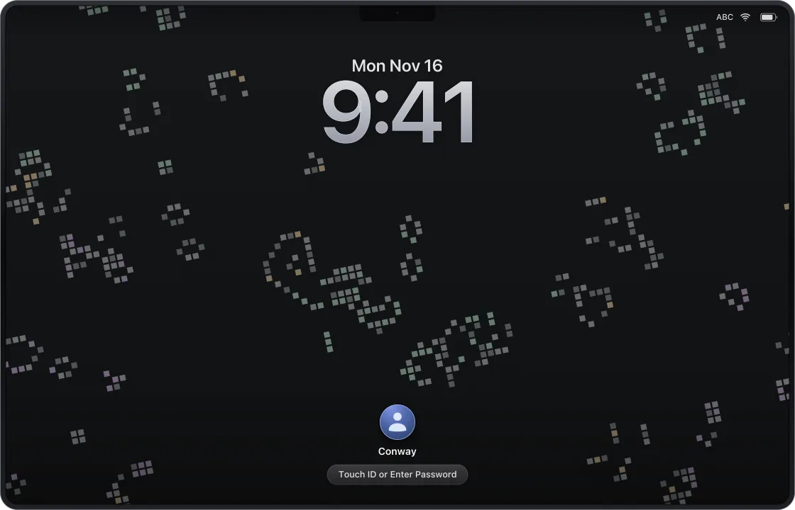
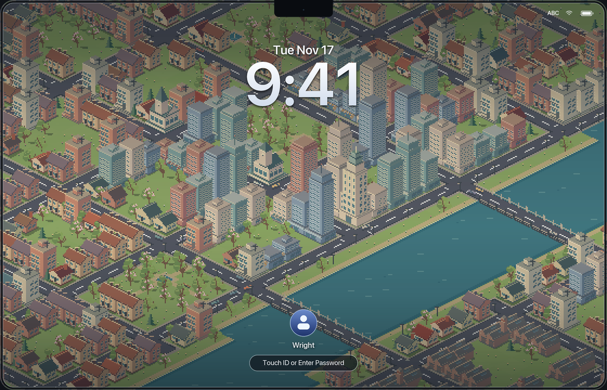

# Live Simulation Wallpapers

A collection of live wallpapers for macOS. Each wallpaper runs a simulation that evolves on your desktop.

## Game of Life

The first wallpaper is based on [Conway’s Game of Life](https://en.wikipedia.org/wiki/Conway%27s_Game_of_Life). Cells on a grid come to life, survive, or die depending on their neighbours. Simple rules produce patterns that can move, repeat, or settle into place.

*Illustrative preview of Game of Life on the macOS Lock Screen.*

[Download Game of Life from GitHub Releases](https://github.com/thomasturrell/live-simulation-wallpapers/releases) · [Game of Life setup and build instructions](Game%20of%20Life/README.md)

## City Simulation

A living isometric pixel-art city with neighbourhoods, a downtown skyline, parks and an industrial waterfront. Traffic follows the road network, new construction gradually changes the city, and streetlights come on after dark. The native macOS 26+ extension animates during saver playback and keeps a separate city checkpoint for each identified display.

*Illustrative preview of City Simulation on the macOS Lock Screen.*

Build with `cd "City Simulation" && ./NativeWallpaper/build.sh`. Move **City Simulation Wallpaper.app** into Applications and open it once to register it. Then select **City Simulation** under both Wallpaper and Screen Saver in System Settings.

[Download City Simulation from GitHub Releases](https://github.com/thomasturrell/live-simulation-wallpapers/releases) · [City Simulation installation, preview and compatibility notes](City%20Simulation/README.md)

## Release downloads

| ZIP | Contents | macOS support |
| --- | --- | --- |
| `Game-of-Life-Native-Wallpaper.zip` | `Game of Life Wallpaper.app` with the embedded `LifeWallpaper.appex` for wallpaper and screen saver playback, plus `INSTALL.md`. | macOS 26 or later. |
| `City-Simulation-Native-Wallpaper.zip` | `City Simulation Wallpaper.app` with the embedded `CityWallpaper.appex` for wallpaper and screen saver playback, plus `README.md` with installation instructions and an `assets/` directory for its image gallery. | macOS 26 or later. |

Each ZIP includes `LICENSE`. The binaries use ad-hoc signing and support Apple silicon and Intel.

GitHub also provides source code ZIP and tar.gz archives for the release tag.

## Publishing a release

1. On GitHub, open **Actions → Release → Run workflow**. Select the branch you want to release from and enter a version tag such as `v1.0.0`.
2. Wait for the workflow to finish. It tests both wallpapers and attaches two ad-hoc signed native wallpaper ZIPs to a draft release, one for each simulation. If the tag exists, the workflow builds its commit. For a new tag, the draft targets the selected branch's commit at the time you ran the workflow.
3. Open the draft from the workflow summary or the **Releases** page. Review the notes and downloads, then click **Publish release**.

Run the workflow again with the same tag to replace the two native wallpaper ZIPs on an existing draft. The workflow also removes the earlier Game of Life desktop-app and wallpaper-and-screen-saver ZIPs from that draft.

For a new tag, use the default branch if your target branch changes GitHub Actions workflow files. GitHub requires a token with Workflows write permission to create releases for those commits.

## Planned wallpapers

- **Systems Design** — watch requests flow between services, queues, and databases in a live system diagram.

## Planned customisation

- **Optional logo overlays** for a personal or company watermark. Supply your own logo or keep the wallpaper unbranded.

## Licence

MIT License.
