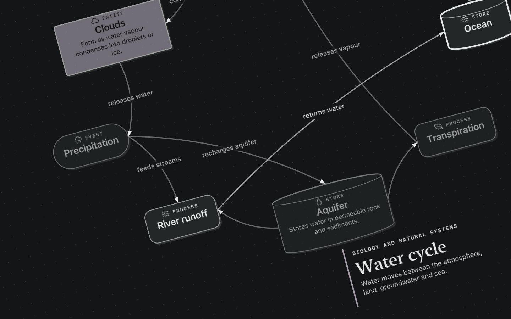

# System Design

Follow electricity from a rooftop into a battery, trace a DNS lookup or watch a river refill its floodplain. System Design is a living diagram of 100 real systems. Each connection names a relationship. Arrows, pulses and changing emphasis let you follow it across a tilted sheet that extends past the edges of the display.


## Install on macOS

Requires macOS 26 or later. The native build supports Apple silicon and Intel Macs.

1. Unzip **System-Design-Native-Wallpaper.zip** from the [collection releases](https://github.com/thomasturrell/live-simulation-wallpapers/releases), or build the app below.
2. Move **System Design Wallpaper.app** to **Applications**. Open it once, click **Done** and keep it in Applications.
3. Reopen **System Settings → Wallpaper** and choose **System Design** under **Simulation Wallpapers**. Choose it under **Wallpaper → Screen Saver → Custom** as well. Repeat on other displays as desired.

## Exploring a system

Each system opens with two components and one arrow between them. About every four to six seconds, another component appears and its connections draw into place until the diagram is complete. As it grows, subsystems open and pulses follow the arrows.

When two systems share a component, the camera settles on its card. The old branches fade, the card takes on its new name and shape, and a connection draws out to the first neighbour. For example, the **Battery bank** in domestic solar power can become the **Cell stack** in battery management. Unrelated systems dissolve into one another on the same dotted paper.

On unlock, the current action has a brief moment to finish. The desktop then holds that frame. Each identifiable display keeps its own place across sessions, and Settings previews use separate, disposable state. Everything needed for playback is in the app.

In the wallpaper options, **Explore** offers the entire catalogue, a subject area or a named system. A named system stays selected and explores different routes within it. There are 25 systems in each of computing and technology, energy and engineering, biology and natural systems, and human and organisational systems.

Choose **Colour** for the Game of Life palettes, including Spectrum, Random and the Mac’s Accent colour. **Appearance** can follow the Mac or use Light or Dark. **Rotation** offers a level view or a fixed 17° tilt. **Varied** picks a direction per display and keeps it as you move between systems or resume a session. **Framing** sets the zoom for the whole tour. Node descriptions, relationship labels and group names can be switched individually. Component names stay visible.

The **System label** is off by default. Choose **Show** to add the system’s name, subject area and description in a corner of the artwork.



## Build and preview

Use a Swift 6 toolchain and the macOS 26 SDK or later. Run these commands from this directory.

```sh
./Packaging/test.sh
./NativeWallpaper/build.sh
swift run DesignPreview
swift run DesignPreview --png /tmp/solar.png 1600 1000 domestic-solar-power 12 green
```

`swift run DesignPreview` opens an animated window. Use **System** to pick a diagram by subject, or choose **Entire catalogue** to explore automatically. **Palette** recolours the current diagram as it plays. Tick **Show system label** to display the caption. The preview uses disposable state.

The native build writes the carrier app and a ZIP to `dist/`. Use `--png` to export a deterministic frame. The optional positional arguments after the dimensions are a system or category ID, elapsed playing seconds, colour and appearance. For example, use `water-cycle 20 blue Dark`. Append `--show-system-label` to include the caption.

## Catalogue and playback

The four JSON arrays in `Sources/DesignEngine/Catalogue/` are the source for the picker and the artwork. Each system has a stable ID, name, description, category and layout. Each node has a local ID, name and semantic kind. Optional `detail`, `symbol`, `group` and `concept` fields add explanatory copy, a built-in macOS symbol, subsystem membership and links to other systems. Groups can name a parent. Each directed edge names its source, target, relationship kind and verb phrase. An edge in each direction can describe a two-way exchange. Use matching concept keys only where a viewer can follow the meaning between the two nodes.

Layouts include horizontal and vertical flows, hierarchies, clusters, rings, hubs and meshes. The engine validates references, group ancestry and connectedness when loading the bundle. It picks a connected reveal order from a seed and keeps recent visits to prefer fresh material. A versioned per-display checkpoint holds the selection, entry component, seed, visit history and position within the current action.

`DesignArt` measures and routes a sheet once, then updates retained Core Animation layers. The PNG exporter, remote wallpaper and snapshots use the same renderer. Game of Life and System Design import the original colour calculations from the local `WallpaperPalette` target in Game of Life. The native adapter uses the collection’s shared WallpaperAgent bridge.

## Verify on a Mac

1. Select the wallpaper and screen saver. Try **Domestic solar power**, change the palette and toggle labels. Confirm the first frame has readable names and a recognisable subject.
2. Lock for five seconds, unlock and watch the desktop settle. Lock again for about a minute. Look for another component appearing, a pulse following an arrow and a change of focus. In **Entire catalogue**, allow time for a transition to another system.
3. Unlock during a reveal or a dissolve. The desktop should come to rest within about three seconds. Compare its position on the next lock. Check Activity Monitor or Instruments for idle CPU use after settling.
4. Try a second display or Space, switch the Mac’s appearance, and open and close Settings previews. Check that the displays resume independently and the preview leaves their histories intact.

macOS owns the remote surfaces. It may suspend or replace one before the settling animation finishes. The extension saves on unlock, on suspension and periodically during playback. A display without a stable identifier has session-local state. macOS updates can change the private WallpaperAgent interface.

This probe exercises the native picker models, snapshots and timer lifecycle without registering the app.

```sh
DESIGN_BUILD_ABI_PROBE=1 DESIGN_NATIVE_ARCHS="$(uname -m)" ./NativeWallpaper/build.sh
.build/native-wallpaper/verify-wallpaper --local \
  "dist/System Design Wallpaper.app/Contents/Extensions/DesignWallpaper.appex/Contents/Resources/design-thumbnail.png" \
  "$(mktemp -d)"
```

Omit `--local` in a graphical login session to exercise remote Core Animation context creation too.
