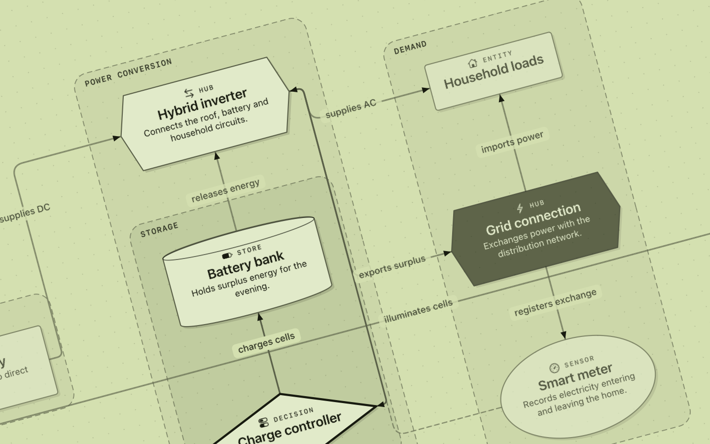

# System Design

Follow electricity from a rooftop into a battery, trace a DNS lookup or watch a river refill its floodplain. System Design brings 100 real systems to your Mac as diagrams on dotted paper. Each arrow tells you how one part connects to the next.

**[Download for macOS](https://github.com/thomasturrell/live-simulation-wallpapers/releases)** · Requires macOS 26 or later.

## Exploring a system

While your screen saver runs, each new diagram opens with two cards and an arrow between them. About every four to six seconds, another part of the system comes into view. A pulse travels along an arrow, a group of related cards opens up, and the diagram grows across the page.

A single card can take you into another system. Follow the **Battery bank** in domestic solar power and you might see it become the **Cell stack** in battery management. The card stays in place as the old branches fade and a new line leads to its first neighbour. Diagrams that share no component dissolve into one another on the same sheet.

When you unlock your Mac, the cards ease down onto the paper and their shadows shorten. After about two seconds the diagram rests on your desktop, ready to carry on next time. Each display keeps its own place when your Mac can identify it. You can try another diagram in Settings without losing your place on the desktop.

## Choose what to explore

In **System Settings → Wallpaper**, set **Explore** to **Entire catalogue**, pick a subject or stay with one system to see different routes through it. Each of the four subjects has 25 systems to explore.

| Subject | A system to try |
| --- | --- |
| Computing and technology | DNS resolution |
| Energy and engineering | Domestic solar power |
| Biology and natural systems | Water cycle |
| Human and organisational systems | Library lending |

## Colour and framing

| Option | What you’ll see |
| --- | --- |
| **Colour** | Choose from the Game of Life palettes, including Spectrum, Random and your Mac’s Accent colour. |
| **Appearance** | Follow your Mac with **Automatic**, or choose **Light** or **Dark**. |
| **Rotation** | Keep the page **Level**, or tilt it 17° to the **Left** or **Right**. **Varied** chooses a direction for each display and keeps it between visits. |
| **Framing** | **Close** brings the cards nearer. **Wide** shows more of the sheet. **Balanced** is the default. |

Component names are always visible. Show or hide **Node descriptions**, **Relationship labels** and **Group names** individually. The **System label** is hidden by default. Choose **Show** to see the system’s name, subject and description in the corner.

*The water cycle in the Original palette with Dark appearance.*

## Install on macOS

1. Download **System-Design-Native-Wallpaper.zip** from [GitHub Releases](https://github.com/thomasturrell/live-simulation-wallpapers/releases) and unzip it.
2. Move **System Design Wallpaper.app** into **Applications**, open it once and click **Done**. Keep the app in Applications.
3. Reopen **System Settings → Wallpaper** and choose **System Design** under **Simulation Wallpapers**. Select it under **Wallpaper → Screen Saver → Custom** too.

Repeat for any other displays where you want the diagrams. Start your screen saver or lock your Mac to follow the first connection.

## Compatibility

Requires **macOS 26 or later**. The download supports Apple silicon and Intel Macs. All 100 systems are included and can be explored offline.

The [developer guide](DEVELOPMENT.md) covers building and previewing the wallpaper, editing the catalogue and verifying playback on a Mac.
